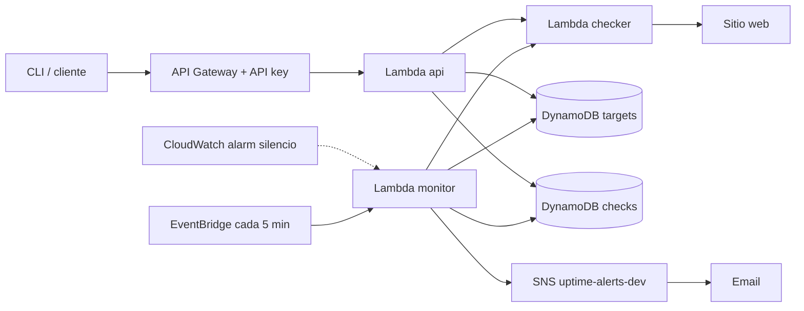
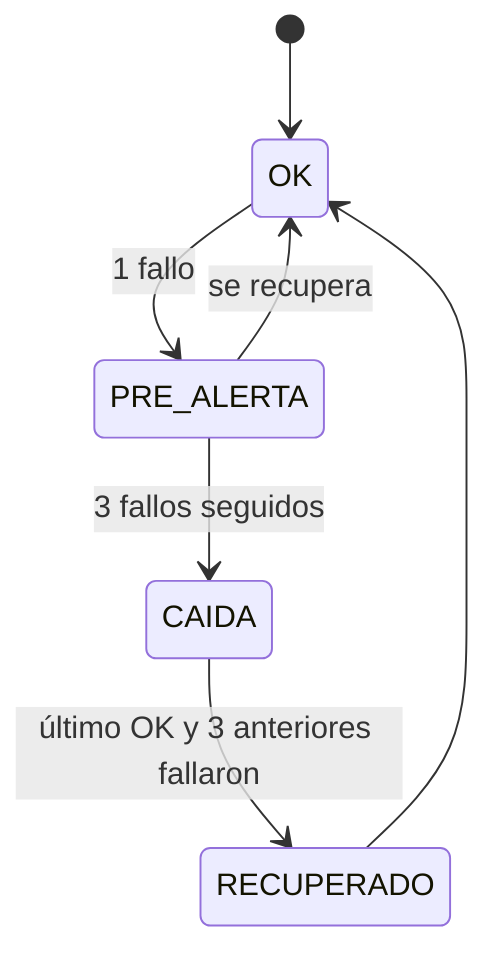

# uptime-sentinel


Serverless website uptime monitor on AWS. It checks your sites every 5 minutes, stores the history of every check, sends email alerts when a site goes down or recovers, and lets you query everything through a protected API or a terminal CLI.

## Table of contents

- [How it works](#how-it-works)
- [Architecture](#architecture)
- [Alert logic](#alert-logic)
- [Security](#security)
- [Requirements](#requirements)
- [CLI usage](#cli-usage)
- [Deployment](#deployment)
- [Tests](#tests)
- [Security scanning in CI](#security-scanning-in-ci)
- [Accepted Checkov findings](#accepted-checkov-findings)
- [Costs](#costs)
- [Roadmap](#roadmap)

## How it works



## Architecture

| Component | Role | Can write |
|---|---|---|
| `checker` | Validates the URL and makes the request | Nothing, it only evaluates |
| `monitor` | Runs the scheduled checks, stores results, triggers alerts | Checks, alerts |
| `api` | Exposes four routes | Targets |
| `cli` | Consumes the API from the terminal | Nothing directly |
| SNS topic `uptime-alerts-dev` | Delivers alerts to the subscribed email | Nothing |
| CloudWatch alarm `uptime-monitor-silent-dev` | Fires if the monitor does not run for 15 minutes | Nothing |

### API routes

| Method | Route | Description |
|---|---|---|
| POST | `/probar` | Checks a URL without saving it |
| POST | `/objetivos` | Saves a URL to monitor |
| GET | `/objetivos` | Lists saved targets |
| GET | `/resultados?url=...` | Shows the history of a URL |

## Alert logic

The monitor evaluates the last four checks of each URL after every run. A check fails if it has a connection error or if the HTTP status is not 200.



Alerts fire only on transitions, so a site that stays down does not flood your inbox. A separate alarm notifies you if the monitor itself stops running.

## Security

The checker rejects any URL that could point to the project's own infrastructure or the internal network:

- HTTPS only, port 443 only, and no credentials in the URL.
- Resolves DNS and rejects non-public addresses, including IPv4-mapped, 6to4, NAT64, and Teredo.
- Connects to the already validated IP, not the hostname, to prevent DNS changes between validation and connection.

The API requires `x-api-key` on every route. A usage plan limits traffic to 5 requests per second, bursts of 10, and a quota of 1000 per day.

Each Lambda has only the permissions it needs:

| Lambda | DynamoDB | Other |
|---|---|---|
| `monitor` | Scan targets, PutItem and Query checks | Publish to the alerts topic, invoke checker |
| `api` | PutItem and Scan targets, Query checks | Invoke checker (for `/probar`) |
| `checker` | None | None |

## Requirements

- Python 3.13 or later
- Terraform 1.10 or later
- AWS CLI with configured credentials
- An AWS account (designed to stay within the free tier)

## CLI usage

Install:

```powershell
pip install -r requirements-cli.txt
```

Configure with your deployment values:

```powershell
$env:UPTIME_API_URL = "<API URL>"
$env:UPTIME_API_KEY = "<API key>"
```

Get the URL from `terraform output api_url` in `infra/envs/dev`. Get the API key from the API Gateway console. It is never stored in the repository.

```powershell
python tools/cli.py --version
python tools/cli.py probar https://example.com/
python tools/cli.py guardar https://example.com/
python tools/cli.py listar
python tools/cli.py resultados https://example.com/
```

| Command | What it does |
|---|---|
| `probar` | Checks the URL and shows the result without saving it |
| `guardar` | Checks the URL and, if it is public, adds it to the targets |
| `listar` | Lists the saved targets |
| `resultados` | Shows the check history for a URL |

Exit codes: `0` on success, `1` if the API returned an error, `2` if configuration is missing or the command is invalid.

## Deployment

Resources live in `infra/envs/dev`. Terraform state is stored in an S3 bucket with native locking.

```powershell
cd infra/envs/dev
cp dev.tfvars.example dev.tfvars
terraform init -backend-config=backend.hcl
terraform plan -out=tfplan
terraform apply tfplan
```

`backend.hcl` and `dev.tfvars` are not in the repository. Create them locally with your own values. `dev.tfvars.example` shows the variables you need.

To remove everything:

```powershell
terraform destroy
```

## Tests

Unit tests, without touching AWS:

```powershell
pip install -r requirements-dev.txt
$env:ALERTS_TOPIC = "arn:aws:sns:us-east-1:000000000000:test"
python -m pytest -v
```

`test_monitor.py` needs the `ALERTS_TOPIC` environment variable before it runs. Any placeholder value works for the tests.

Integration tests against the deployed infrastructure, marked `integration` and excluded by default:

```powershell
python -m pytest -m integration -v
```

## Security scanning in CI

The Seguridad workflow runs on every push and pull request:

- Gitleaks scans the full git history for secrets.
- Checkov analyzes the Terraform code. It runs with `--soft-fail`, so findings are reviewed manually and listed below.

## Accepted Checkov findings

Checkov reports 38 findings. Each one is accepted for cost, design, or because it does not apply to an app of this size:

| Check | Resource | Reason |
|---|---|---|
| CKV_AWS_26 | SNS topic | KMS encryption has a cost. `alias/aws/sns` also blocks CloudWatch from publishing to the topic. |
| CKV_AWS_119, CKV_AWS_28 | DynamoDB | CMK encryption has a cost. PITR is skipped because monitoring data is disposable. |
| CKV_AWS_158, CKV_AWS_338 | Log groups | KMS encryption has a cost. Retention is 14 days, not one year, to avoid storage costs. |
| CKV_AWS_173 | Lambda env vars | CMK encryption has a cost. Default encryption is used. |
| CKV_AWS_115 | Lambdas | No concurrency limit. Traffic is low and the API already caps requests at 5 rps. |
| CKV_AWS_50, CKV_AWS_73 | Lambdas, API stage | X-Ray generates a cost per trace. |
| CKV_AWS_117 | Lambdas | No VPC. The checker needs public internet access, and a VPC requires a NAT Gateway, which has a cost. |
| CKV_AWS_116 | Lambdas | No DLQ. The monitor is scheduled, so the next run retries. |
| CKV_AWS_272 | Lambdas | Code signing is out of scope for this project. |
| CKV_AWS_120, CKV_AWS_225 | API stage, method settings | API Gateway caching is billed per hour. |
| CKV2_AWS_29 | API stage | WAF has a fixed monthly cost. |
| CKV2_AWS_51 | API stage | Client certificates require a PKI. The API uses API keys instead. |
| CKV2_AWS_53 | API methods | Request validation happens in the Lambda code. |

## Costs

The whole project uses free-tier services. The monitor writes to DynamoDB every 5 minutes, which is negligible. Even so, the infrastructure is destroyed after each verification so nothing keeps running.

## Roadmap

- [x] Checker, API, and monitor
- [x] Alerts by SNS and silence alarm
- [x] Security scanning in CI with Gitleaks and Checkov
- [ ] Deployment from GitHub Actions with OIDC
- [ ] `riesgo.py` with a baseline and a 0-100 risk index
- [x] Documented incident case


