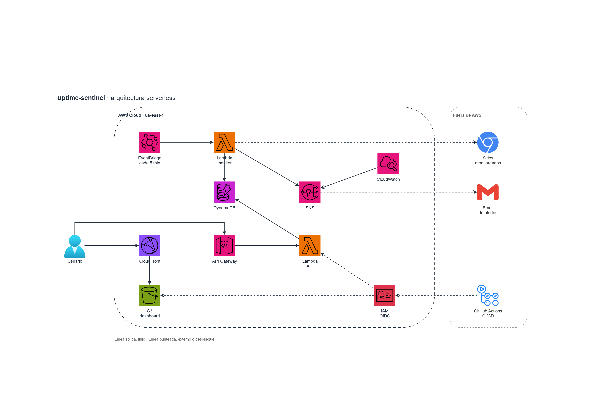

# uptime-sentinel

Monitor de disponibilidad serverless en AWS, con costo cero. Revisa URLs cada
5 minutos, guarda el historial y calcula un índice de riesgo (0-100) que genera
pre-alertas antes de una caída.

## Estado

Fase 1 en curso: base del repo y Terraform con estado remoto.

## Stack

EventBridge · Lambda (Python) · DynamoDB · API Gateway · SNS · S3 · CloudFront ·
CloudWatch · Terraform · GitHub Actions (OIDC)

## Licencia

MIT