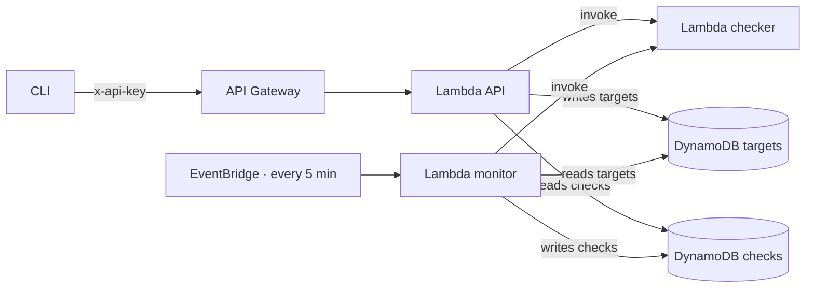

# uptime-sentinel

Serverless website uptime monitor on AWS. It checks your sites every 5 minutes, stores the history of every check, and lets you query it through a protected API or a terminal CLI.


## Table of contents

- [What it does](#what-it-does)
- [Architecture](#architecture)
- [Security](#security)
- [Requirements](#requirements)
- [CLI usage](#cli-usage)
- [Deployment](#deployment)
- [Tests](#tests)
- [Costs](#costs)

## What it does

- **Checks URLs on a fixed interval**: an EventBridge rule triggers the monitor every 5 minutes.
- **Stores history**: every check is saved in DynamoDB with its status, response time, and error if any.
- **Validates before saving**: a URL is only accepted if it is public and uses HTTPS.
- **Query from the terminal**: the CLI shows targets and results in tables.

A portfolio project to practice DevOps and cloud on real infrastructure, deployed with Terraform.

## Architecture



| Component | Role | Can write |
|---|---|---|
| **checker** | Validates the URL and makes the request | Nothing, it only evaluates |
| **monitor** | Runs the scheduled checks on all targets | Checks |
| **API** | Exposes four routes | Targets |
| **CLI** | Consumes the API from the terminal | Nothing directly |

## Security

The checker rejects any URL that could point to the project's own infrastructure or the internal network:

- HTTPS only, port 443 only, and no credentials in the URL.
- Resolves DNS and rejects non-public addresses, including IPv4-mapped, 6to4, NAT64, and Teredo.
- Connects to the already validated IP, not the hostname, to prevent DNS changes between validation and connection.

The API requires `x-api-key` on every route. A usage plan limits traffic to 5 requests per second, bursts of 10, and a quota of 1000 per day.

Each Lambda has only the permissions it needs: the monitor reads targets and writes checks, the API writes targets and reads checks, and the checker has no table access at all.

## Requirements

- Python 3.13 or later
- Terraform 1.10 or later
- AWS CLI with configured credentials
- An AWS account (the project is designed to stay within the free tier)

## CLI usage

Install:

```powershell
pip install -r requirements-cli.txt
```

Configure with your deployment values:

```powershell
$env:UPTIME_API_URL = "<API URL>"
$env:UPTIME_API_KEY = "<API key>"
```

Get the URL from `terraform output api_url` in `infra/envs/dev`. Get the API key from the API Gateway console. It is never stored in the repository.

Commands:

```powershell
python tools/cli.py --version
python tools/cli.py probar https://example.com/
python tools/cli.py guardar https://example.com/
python tools/cli.py listar
python tools/cli.py resultados https://example.com/
```

| Command | What it does |
|---|---|
| `probar` | Checks the URL and shows the result without saving it |
| `guardar` | Checks the URL and, if it is public, adds it to the targets |
| `listar` | Lists the saved targets |
| `resultados` | Shows the check history for a URL |

Exit codes: `0` on success, `1` if the API returned an error, `2` if configuration is missing or the command is invalid.

## Deployment

Resources live in `infra/envs/dev`. Terraform state is stored in an S3 bucket with native locking.

```powershell
cd infra/envs/dev
terraform init -backend-config=backend.hcl
terraform plan -out=tfplan
terraform apply tfplan
```

`backend.hcl` is not in the repository. It holds the state bucket configuration and is created locally.

To remove everything:

```powershell
terraform destroy
```

## Tests

Unit tests, without touching AWS:

```powershell
python -m pytest -v
```

Integration tests against the deployed infrastructure, marked `integration` and excluded by default:

```powershell
python -m pytest -m integration -v
```

## Costs

The whole project uses free-tier services. The monitor writes to DynamoDB every 5 minutes, which is negligible. Even so, the infrastructure is destroyed after each verification so nothing keeps running.
