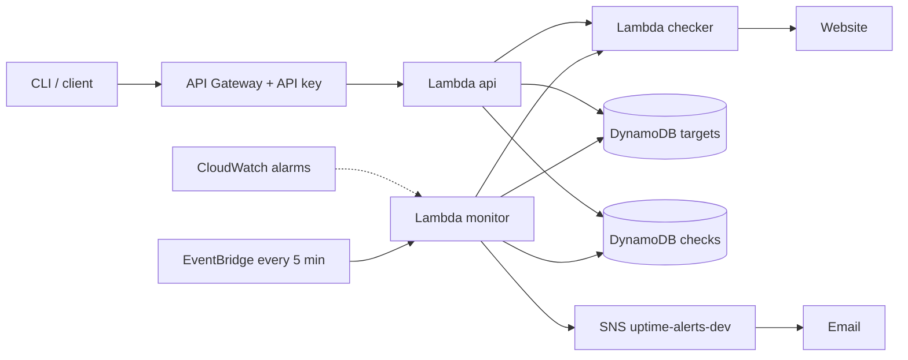
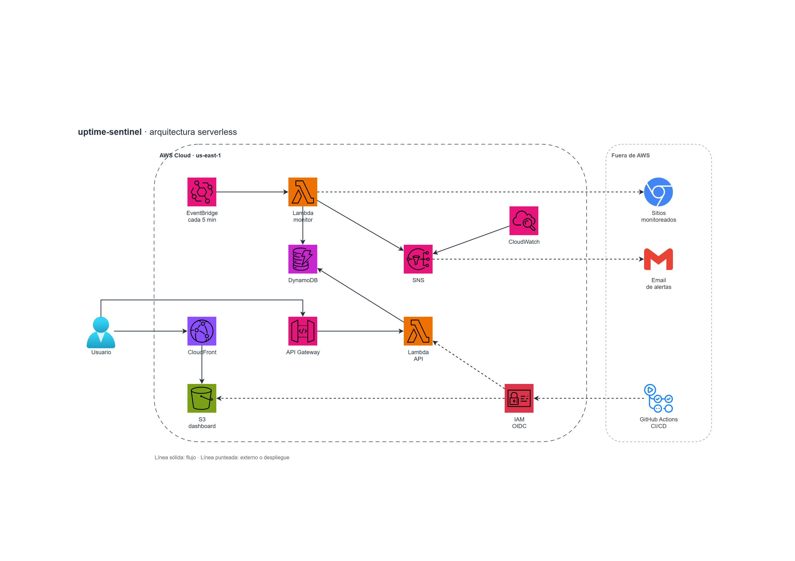
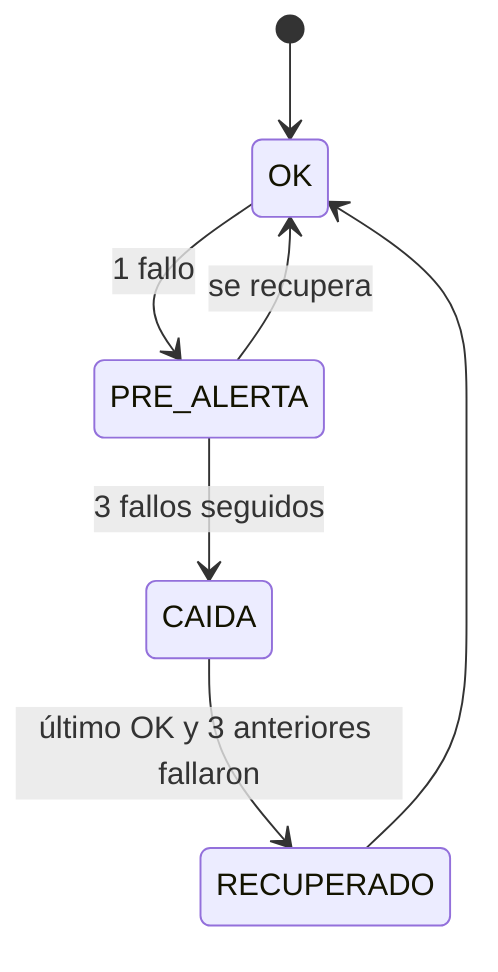

# uptime-sentinel


Serverless website uptime monitor on AWS. It checks your sites every 5 minutes, stores the history of every check, sends email alerts when a site goes down or recovers, and lets you query everything through a protected API or a terminal CLI.

## Table of contents

- [Overview](#overview)
- [How it works](#how-it-works)
- [Architecture](#architecture)
- [Alert logic](#alert-logic)
- [Security](#security)
- [Requirements](#requirements)
- [CLI usage](#cli-usage)
- [Deployment](#deployment)
- [Tests](#tests)
- [Security scanning in CI](#security-scanning-in-ci)
- [Accepted Checkov findings](#accepted-checkov-findings)
- [Design decisions and known limitations](#design-decisions-and-known-limitations)
- [Costs](#costs)
- [Roadmap](#roadmap)

## Overview

uptime-sentinel answers one question: is my website up right now, and was it up yesterday? It runs entirely on AWS serverless services, so there are no servers to patch or keep running. You register a URL once, and from then on the system checks it every 5 minutes, keeps a history, and emails you when something changes.

The project is built to be small, auditable, and cheap. Every part has a single responsibility, and the security decisions are documented where they are made.

## How it works



1. **EventBridge** triggers the monitor every 5 minutes.
2. **The `monitor` Lambda** reads the enabled URLs from the `targets` table and invokes the checker for each one, up to 8 at a time.
3. **The `checker` Lambda** validates the URL, makes the HTTPS request, and returns the result: status code, error if any, and timings for DNS, connection, TLS, and response.
4. The monitor stores each result in the `checks` table, looks at the most recent checks, and publishes to **SNS** when the state changes. SNS delivers the email.
5. **API Gateway and the `api` Lambda** expose four routes to test a URL, save a URL, list targets, and read the history. The CLI consumes that API.

## Architecture



| Component | Role | Can write |
|---|---|---|
| `checker` | Validates the URL and makes the request | Nothing, it only evaluates |
| `monitor` | Runs the scheduled checks, stores results, triggers alerts | Checks, alerts |
| `api` | Exposes four routes | Targets |
| `cli` | Consumes the API from the terminal | Nothing directly |
| SNS topic `uptime-alerts-dev` | Delivers alerts to the subscribed email | Nothing |
| CloudWatch alarm `uptime-monitor-silent-dev` | Fires if the monitor does not run for 15 minutes | Nothing |
| CloudWatch alarm `uptime-monitor-errors-dev` | Fires if the monitor fails in a run | Nothing |

Each component can only write what its role requires. The checker is read-only by design: it never touches the database.

### API routes

| Method | Route | Description |
|---|---|---|
| POST | `/probe` | Checks a URL without saving it |
| POST | `/targets` | Saves a URL to monitor (optional `expected_status`) |
| GET | `/targets` | Lists saved targets |
| GET | `/results?url=...` | Shows the history of a URL |

Every route requires the `x-api-key` header.

## Alert logic

After every run, the monitor looks at the last four checks of each URL. A check counts as a failure if it has an error, no status code, or a status that is not OK. By default, any 2xx or 3xx status is OK. If a target has `expected_status` set, only that exact status is OK.



- **PRE-ALERT**: the first failure.
- **DOWN**: three consecutive failures. It fires once, on the third failure, and does not repeat on the fourth.
- **RECOVERED**: the latest check is OK and the three before it failed.
- **RISK**: a 0-100 risk index (in `src/risk.py`) that compares the last 4 checks with the baseline before them. It needs at least 24 checks per URL and alerts when it crosses 50.

Alerts fire only on transitions, so a site that stays down does not flood your inbox. Two separate alarms notify you if the monitor itself stops running or fails, which covers the case where the monitoring is the thing that broke.

## Security

The checker makes requests to URLs chosen by the user, which can be abused to reach internal services, such as the AWS metadata endpoint. It defends against that in several layers:

- HTTPS only, port 443 only, and no credentials in the URL.
- Resolves DNS and rejects the URL if any resolved address is non-public, including IPv4-mapped, 6to4, NAT64, and Teredo forms.
- Connects to the already validated IP, not the hostname, to prevent DNS changes between validation and connection.
- Does not follow redirects. A 3xx response is reported as the status the site returned.
- Errors returned to the client use fixed messages, without internal details.

The API requires `x-api-key` on every route. A usage plan limits traffic to 5 requests per second, bursts of 10, and a quota of 1000 per day.

Each Lambda has only the permissions it needs:

| Lambda | DynamoDB | Other |
|---|---|---|
| `monitor` | Scan targets, PutItem and Query checks | Publish to the alerts topic, invoke checker |
| `api` | PutItem and Scan targets, Query checks | Invoke checker (for `/probe`) |
| `checker` | None | None |

## Requirements

- Python 3.13 or later
- Terraform 1.10 or later
- AWS CLI with configured credentials
- An AWS account (designed to stay within the free tier)

## CLI usage

Install:

```powershell
pip install -r requirements-cli.txt
```

Configure with your deployment values:

```powershell
$env:UPTIME_API_URL = "<API URL>"
$env:UPTIME_API_KEY = "<API key>"
```

Get the URL from `terraform output api_url` in `infra/envs/dev`. Get the API key from the API Gateway console or with `aws apigateway get-api-key --api-key <api_key_id> --include-value`. It is never stored in the repository.

```powershell
python tools/cli.py --version
python tools/cli.py probe https://example.com/
python tools/cli.py save https://example.com/
python tools/cli.py save https://example.com/status --expected-status 200
python tools/cli.py list
python tools/cli.py results https://example.com/
```

| Command | What it does |
|---|---|
| `probe` | Checks the URL and shows the result without saving it |
| `save` | Checks the URL and, if it is public, adds it to the targets. `--expected-status` sets the only status that counts as OK |
| `list` | Lists the saved targets |
| `results` | Shows the check history for a URL |

Exit codes: `0` on success, `1` if the API returned an error, `2` if configuration is missing or the command is invalid.

## Deployment

Resources live in `infra/envs/dev`. Terraform state is stored in an S3 bucket with native locking, so two applies cannot overwrite each other.

```powershell
cd infra/envs/dev
cp dev.tfvars.example dev.tfvars
terraform init -backend-config=backend.hcl
terraform plan -out=tfplan
terraform apply tfplan
```

`backend.hcl` and `dev.tfvars` are not in the repository. Create them locally with your own values. `dev.tfvars.example` shows the variables you need.

Deployment is manual. There is no CI pipeline that applies changes to AWS.

To remove everything:

```powershell
terraform destroy
```

## Tests

Unit tests, without touching AWS. They use mocks for boto3, sockets and HTTP, and cover:

- **Checker**: non-public IP detection, URL rules, pinned connection, total deadline, redirects, path encoding.
- **Monitor**: alert transitions, pagination, partial failures, parallel invocations.
- **API**: every route, every error code, `expected_status` validation, no internal details leaked.
- **CLI**: every command and every error path.
- **Risk index**: baseline, recovery, expected status, and edge cases.

```powershell
pip install -r requirements-dev.txt
python -m pytest -v
```

`tests/conftest.py` sets placeholder values for the environment variables the code reads at import time, so no AWS configuration is needed to run the unit tests.

Integration tests run against the deployed infrastructure. They are marked `integration` and excluded by default. They write real data to DynamoDB, invoke the live Lambdas, and call the live API, so run them on purpose. Set the deployed names first:

```powershell
$env:CHECKER_FUNCTION = "uptime-checker-dev"
$env:MONITOR_FUNCTION = "uptime-monitor-dev"
$env:TARGETS_TABLE = "uptime-targets-dev"
$env:RESULTS_TABLE = "uptime-checks-dev"
python -m pytest tests/integration -v -m integration
```

## Security scanning in CI

The Seguridad workflow runs on every push and pull request:

- **Gitleaks** scans the commits of each push and pull request in CI. Run `gitleaks detect --source . -v` locally to scan the full git history.
- **Checkov** analyzes the Terraform code. It runs with `--soft-fail`, so findings are reviewed manually and listed below.

## Accepted Checkov findings

Checkov reports 38 findings. Each one is accepted for cost, design, or because it does not apply to an app of this size:

| Check | Resource | Reason |
|---|---|---|
| CKV_AWS_26 | SNS topic | KMS encryption has a cost. The AWS-managed key `alias/aws/sns` would also block CloudWatch alarms from publishing to the topic. |
| CKV_AWS_119, CKV_AWS_28 | DynamoDB | CMK encryption has a cost. PITR is skipped because monitoring data is disposable. |
| CKV_AWS_158, CKV_AWS_338 | Log groups | KMS encryption has a cost. Retention is 14 days, not one year, to avoid storage costs. |
| CKV_AWS_173 | Lambda env vars | CMK encryption has a cost. Default encryption is used. |
| CKV_AWS_115 | Lambdas | No concurrency limit. Traffic is low and the API already caps requests at 5 rps. |
| CKV_AWS_50, CKV_AWS_73 | Lambdas, API stage | X-Ray generates a cost per trace. |
| CKV_AWS_117 | Lambdas | No VPC. The checker needs public internet access, and a VPC requires a NAT Gateway, which has a cost. |
| CKV_AWS_116 | Lambdas | No DLQ. The monitor is scheduled, so the next run retries. |
| CKV_AWS_272 | Lambdas | Code signing is out of scope for this project. |
| CKV_AWS_120, CKV_AWS_225 | API stage, method settings | API Gateway caching is billed per hour. |
| CKV2_AWS_29 | API stage | WAF has a fixed monthly cost. |
| CKV2_AWS_51 | API stage | Client certificates require a PKI. The API uses API keys instead. |
| CKV2_AWS_53 | API methods | Request validation happens in the Lambda code. |
| CKV_AWS_237 | API Gateway REST API | Create before destroy is not set on the root resource. The deployment already sets it (CKV_AWS_217 passes), and replacing the root API is rare in this project. |

## Design decisions and known limitations

- **Redirects are not followed.** The checker reports the status the site returns. A 3xx counts as up. Following redirects safely would mean re-running the full URL validation on every hop.
- **Checks run in parallel, with a limit.** The monitor invokes the checker for up to 8 URLs at a time. Each check has a 15-second total deadline, and the checker Lambda has a 25-second timeout.
- **Risk index needs history.** It is only calculated after 24 checks per URL, so it stays empty for new targets.
- **Monitoring data is disposable.** DynamoDB does not use point-in-time recovery, and logs are kept for 14 days. This is intentional for a project of this size.
- **No pipeline.** Deployment is manual with Terraform. There is no workflow that applies changes to AWS.

## Costs

The whole project is designed to run on free-tier services. The monitor invokes the checker and writes to DynamoDB every 5 minutes, about 8,600 times a month, which is negligible. The two alarms and the log groups cost cents per month at most. Lambda time, DynamoDB capacity (5 RCU and 5 WCU per table) and SNS emails stay within the always-free limits. The API Gateway free tier lasts 12 months, after which requests are billed per call. The infrastructure can be destroyed with `terraform destroy` when it is not in use, so nothing keeps running.

## Roadmap

- [x] Checker, API, and monitor
- [x] Alerts by SNS and silence and error alarms
- [x] Parallel checks and `expected_status` per target
- [x] Security scanning in CI with Gitleaks and Checkov
- [x] `src/risk.py` with a baseline and a 0-100 risk index
- [x] Documented incident case
